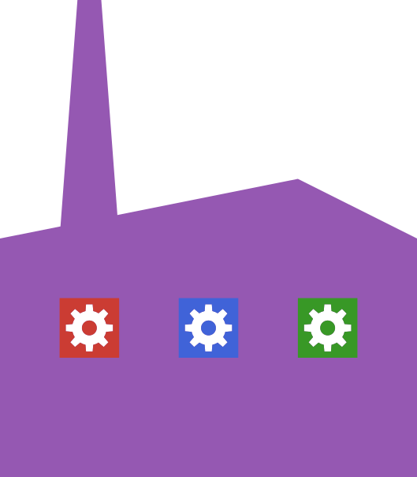

# H2FactoryTestUtils

  

## Introduction

The H2FactoryTestUtils package provides Julia helpers for testing
[H2Factory](https://github.com/djukic14/H2Factory.jl) maps against dense references.
It also provides small synthetic maps for testing translations and tree passes
without a full application setup.

The package provides:

* **Map checks**: `checkinteractions` checks sizes, the near/far partition, and matrix-vector products.
* **Product checks**: `checkmul` and `checkproduct` compare `mul!` and `A * x` with a reference. `checknearmul` and `checkfarmul` check each contribution separately.
* **Translation checks**: `checki2otranslation` checks an I2O pair, including basis conversion.
* **Synthetic maps**: `fakegalerkinmap` and `fakepetrovmap` accept replaceable translators. `faketoeplitzmap` and `fakepetrovtoeplitzmap` exercise FFT-based couplings.
* **Interpolation fixtures**: `minih2matrix` and `minipetrovh2matrix` provide both the chosen approximation and exact kernel samples for comparison.
* **Dense references**: `denseh2matrix(A)` assembles a synthetic map's far-field reference without using its `mul!`.

The check helpers report assertions through `Test` and can be used inside a testset.
Pass the reference first and the map second. For transpose and adjoint checks,
orient both arguments.

## Limits

- Product checks use sampled inputs; passing does not prove accuracy for every
  vector. Helpers use fixed default seeds. Where an `rng` keyword is available,
  pass another generator to try additional inputs.
- `estimatenorm` and `estimaterelnormdifference` use power iteration. Their
  results are estimates, not guaranteed bounds.
- `denseh2matrix` and the interpolation fixtures' `dense_approx` and `dense_true`
  describe far interactions only. Near contributions must be included separately
  when comparing a full operator. `dense_approx` checks execution of the chosen
  approximation; comparison with `dense_true` measures approximation error.

## Documentation

* Function arguments and specialized fixtures are described in the docstrings.
  Use `?checkmul` or `?checki2otranslation` in the Julia REPL.
* [Contributing and running tests](CONTRIBUTING.md).
